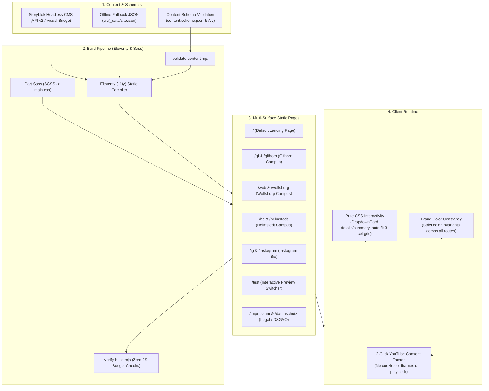

# Echo Link-Tree

A high-performance, static-first, privacy-compliant link-in-bio website with Storyblok headless CMS visual editing, multi-location surface routing, and pure-CSS responsive components.

[](https://app.netlify.com)

---

## 1. System Architecture



---

## 2. Key Features

- **Multi-Location Surface Routing**: Dedicated, blazing-fast static routes (`/gf`, `/gifhorn`, `/wob`, `/wolfsburg`, `/he`, `/helmstedt`, `/ig`, `/instagram`, `/test`) generated at build time with clean canonical URLs.
- **Brand Color Constancy**: Strict adherence to the Echo brand palette across all routes. City switches, surfaces, and query parameters filter content without changing brand colors.
- **Collapsible Service Times Card (`DropdownCard`)**:
  - Implemented with pure CSS `<details>` / `<summary>` (100% accessible, zero client-side JavaScript required).
  - Responsive 3-column auto-fit grid (`repeat(auto-fit, minmax(200px, 1fr))`) that stacks gracefully on mobile.
  - Centered button label and icon layout.
  - Fully editable mini cards (`title`, `time`, `location`, `details`, `url`, `actionLabel`, `hasKids`, `kidsLabel`).
  - Built-in **Echo Kids available** indicator badge with inline child SVG icon.
- **Dual-Tier Content Curation**:
  - **Tier 1 (`display_in_default`)**: Boolean switch on every component to curate the default homepage (`/`) independently.
  - **Tier 2 (`show_on` / `hide_on`)**: Target components to specific campus routes (`gifhorn`, `wolfsburg`, `helmstedt`, `instagram`).
- **Privacy-First (GDPR / DSGVO Compliant)**:
  - Zero cookies on initial page visit (no cookie banner required).
  - 2-click consent YouTube video player facade (`video-embed.js`, < 1.5 KB): YouTube iframes load only after an explicit click, using `youtube-nocookie.com`.
  - Supports standard YouTube video IDs (`youtube_video_id`), regular videos, and scheduled or active livestreams (`youtube_content_type: "live"`).
- **Headless Storyblok Integration**:
  - Visual Editor bridge for live inline editing in the browser.
  - Offline local fallback data in `src/_data/site.json` ensures development and builds never fail if the API is unreachable.
  - 12 fully declared Storyblok components in `storyblok/components.json`.

---

## 3. Component Hierarchy

```
link_page (Page Root)
├── profile_header (Logo avatar, church name, bio tagline)
├── body (Ordered list of content blocks)
│   ├── link_button (Full-width button with custom icon)
│   ├── dropdown_card (Collapsible service times card)
│   │   └── dropdown_time_item (Service mini cards with time & Echo Kids badge)
│   ├── image_card_horizontal (16:9 featured horizontal card with title & arrow)
│   ├── image_card_vertical (3:4 portrait flyer card with title & arrow)
│   ├── video_link_card (Privacy 2-click video card with YouTube ID support)
│   ├── group_block (Container box for grouping nested buttons and cards)
│   └── section_heading (Uppercase category divider)
└── footer_legal (Organization info, Impressum & Datenschutz links, social buttons)
    └── social_item (Circular icon buttons for Instagram, YouTube, Spotify, WhatsApp)
```

---

## 4. Development & Build Commands

```bash
# Install dependencies
npm install

# Start local development server (live reloading with Eleventy & Sass)
npm run dev

# Validate data against JSON Schema
npm run validate

# Production build (Validate -> Compile Sass -> Build Eleventy -> Verify output)
npm run build

# Run automated test suites (28 tests: markup, interactive states, surfaces)
npm test

# Push component schemas to Storyblok Space
npm run storyblok:push -- --space <YOUR_SPACE_ID>

# Pull component schemas from Storyblok Space
npm run storyblok:pull -- --space <YOUR_SPACE_ID>
```

---

## 5. Documentation & Guides

- [**System Architecture & Technical Specification**](file:///Users/Shared/projeckt/goto/link-tree/docs/ARCHITECTURE.md): Complete architecture blueprint, technical stack, security headers, and data flow.
- [**Storyblok Component Reference & Editor Guidelines**](file:///Users/Shared/projeckt/goto/link-tree/docs/STORYBLOK.md): Detailed component documentation in **English** and **Einfaches Deutsch (German)** for content editors.
- [**Beginner Storyblok Starter Setup Guide**](file:///Users/Shared/projeckt/goto/link-tree/STORYBLOK-STARTER-GUIDE.md): Step-by-step setup guide for creating a Storyblok space, obtaining tokens, pushing schemas, and setting up the Visual Editor.
- [**Design System & Styleguide**](file:///Users/Shared/projeckt/goto/link-tree/docs/STYLEGUIDE.md): Typography, color tokens, button states, and spacing scale.
- [**Legal & Privacy Guide (Germany/EU)**](file:///Users/Shared/projeckt/goto/link-tree/docs/LEGAL-PRIVACY-DE.md): DDG/DSGVO compliance requirements and configuration.
- [**Agent Skills & Implementation Boundaries**](file:///Users/Shared/projeckt/goto/link-tree/SKILLS.md): Operational boundaries and rules for AI coding agents.
