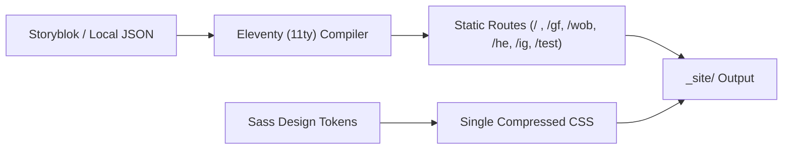

# SKILLS.md

This file describes the capabilities an implementation agent should use and the architectural boundaries it must respect.

---

## Architecture Overview

---

## Skill: static-site-architecture

Use when creating or changing page structure, routing, layouts, or build behavior.

Rules:
- favor generated HTML over runtime rendering;
- preserve zero-JS baseline output;
- keep deployment portable between Netlify and Cloudflare Pages;
- do not couple content to a hosting provider.

Deliverables:
- Eleventy config (`eleventy.config.mjs`);
- layouts/partials/components in `src/_includes/`;
- predictable static output in `_site/`.

---

## Skill: dropdown-card-and-times-architecture

Use when creating, editing, or styling service times, campus schedules, and collapsible cards.

Rules:
- **Pure CSS `
` / `
`**: Interactivity must function without any client-side JavaScript.
- **Centered Header Content**: The summary button must center its label and church icon.
- **Responsive 3-Column Grid**: Defaults to an auto-fit grid (`repeat(auto-fit, minmax(200px, 1fr))`) that wraps cleanly on mobile devices.
- **100% Editable Mini Cards**: All sub-properties (`title`, `time`, `location`, `details`, `url`, `actionLabel`, `hasKids`, `kidsLabel`, `showOn`, `hideOn`) must be exposed in schemas and editable by content editors.
- **Echo Kids Indicator**: Toggle badge with an inline child SVG icon and customizable label (default: `"Echo Kids verfügbar"`).
- **Surface Scoping**: Filter internal columns using `filterBySurface` so that dedicated city pages (e.g., `/gf`) display their respective services (e.g., Gifhorn 10:00 & 12:00 in BSK-Saal), while `/` displays all active default cards.

Deliverables:
- `src/_includes/components/DropdownCard.njk`;
- `src/styles/components/_dropdown-card.scss`;
- schema entries in `content.schema.json` and `storyblok/components.json`.

---

## Skill: dual-tier-curation

Use when managing visibility between the main default landing page and dedicated location/channel routes.

Rules:
- **Tier 1 (`display_in_default` / `displayInDefault`)**: Boolean toggle on every component and mini card.
  - When `true` (or omitted), item appears on the default landing page (`/`).
  - When `false`, item is hidden from the default landing page (`/`), allowing editors to curate a clean, focused default homepage.
- **Tier 2 (`show_on` / `hide_on`)**: Multi-select target array (`gifhorn`, `wolfsburg`, `helmstedt`, `instagram`).
  - Items with `displayInDefault: false` and `showOn: ["gifhorn"]` will only appear on `/gf` and `/gifhorn`.
- On `/test`, all items remain present and can be toggled via the interactive toolbar.

Deliverables:
- `displayInDefault` property in `content.schema.json`;
- `display_in_default` field across all components in `storyblok/components.json`;
- filter logic in `eleventy.config.mjs` (`filterBySurface`) and `src/assets/js/surface-switcher.js`.

---

## Skill: content-schema

Use when adding or modifying profile data, links, media cards, surfaces, or display rules.

Rules:
- schema-first;
- validate build input with Ajv (`npm run validate`);
- reject unknown item types unless intentionally versioned;
- treat all authored HTML as untrusted unless explicitly sanitized.

Deliverables:
- `content.schema.json`;
- example content in `examples/content.json` and `src/_data/site.json`;
- validation script (`scripts/validate-content.mjs`).

---

## Skill: storyblok-component

Use whenever a UI component or visual variant changes.

Rules:
- Maintain all 12 Storyblok blok schemas in `storyblok/components.json`:
  1. `link_page` (Page Root)
  2. `profile_header` (Logo, Name, Bio)
  3. `link_button` (Standard Action Button)
  4. `dropdown_card` (Collapsible Service Times Card)
  5. `dropdown_time_item` (Service Time Mini Card)
  6. `image_card_horizontal` (16:9 Media Card)
  7. `image_card_vertical` (3:4 Flyer Card)
  8. `video_link_card` (Privacy 2-Click YouTube Card)
  9. `group_block` (Container Box)
  10. `section_heading` (Category Divider)
  11. `footer_legal` (Legal & Contact Information)
  12. `social_item` (Social Media Icon Button)
- Production markup rendered by Eleventy templates must strictly match the component specifications;
- Support Storyblok `_editable` attributes for live visual click-to-edit in the Storyblok bridge.

Deliverables:
- `storyblok/components.json`;
- documentation in `docs/STORYBLOK.md` (English and German).

---

## Skill: sass-design-system

Use for all presentation work.

Rules:
- update tokens before scattering new values;
- semantic tokens are preferred over literal colors in components;
- new brand/styleguide inputs should primarily change token files, not component selectors;
- keep components themeable through CSS custom properties;
- **Strict adherence to brand colors**: never change colors based on URL parameters, surfaces, or sublinks. Brand identity and action colors must remain unified and consistent across all pages and views.

Deliverables:
- token updates in `src/styles/tokens/`;
- component SCSS in `src/styles/components/`;
- single compiled output `_site/css/main.css`.

---

## Skill: surface-routing-and-switching

Use when configuring or modifying surfaces, localized city routes, channel targeting, or test preview environments.

Rules:
- Standard surface shortcuts and canonical routes:
  - `<domain>/ig` and `<domain>/instagram` -> switch `instagram`
  - `<domain>/wob` and `<domain>/wolfsburg` -> switch `wolfsburg`
  - `<domain>/gf` and `<domain>/gifhorn` -> switch `gifhorn`
  - `<domain>/he` and `<domain>/helmstedt` -> switch `helmstedt`
- Default behavior:
  - Surface-specific buttons and items (`showOn: ['gifhorn']`, `showOn: ['wolfsburg']`, etc.) must NOT be shown on the default route (`/`).
  - Only general links or items with `displayInDefault: true` are visible on `/`.
- Test preview switcher:
  - The interactive switcher toolbar (`.surface-switcher`) is ONLY rendered on `/test` (`/test/index.html`).
  - Production landing routes (`/`, `/gf`, `/wob`, etc.) remain uncluttered and show only the final tailored link list.
- Query parameter support:
  - `?surface=<slug>` and `?switch=<slug>` work dynamically across all pages via `surface-switcher.js`.
- Brand color preservation:
  - Surfaces strictly control content filtering/targeting only; they must NEVER change brand colors.

Deliverables:
- `src/_data/surfaces.js` route definitions;
- `src/content/surfaces.njk` static multi-route pagination;
- `src/content/test.njk` test preview route;
- `src/assets/js/surface-switcher.js` helper.

---

## Skill: privacy-review

Use whenever adding analytics, embeds, forms, external assets, CDNs, scripts, storage, or third-party network requests.

Rules:
- strict privacy profile remains default;
- document every new external domain and purpose;
- do not add consent banners merely as decoration;
- 2-click consent facade for YouTube (`video-embed.js`) ensures no tracking cookies or iframes load on page visit.

Deliverables:
- update `docs/PRIVACY-DEPENDENCIES.md`;
- update legal/privacy implementation notes.

---

## Skill: germany-legal-page-integration

Use to implement the legal-page templates and operator-config structure.

Rules:
- do not fabricate legal details;
- keep operator identity/contact data in `src/_data/operator.json`;
- use stable routes `/impressum/` and `/datenschutz/`.

Deliverables:
- templates in `src/content/impressum.njk` and `src/content/datenschutz.njk`.

---

## Skill: deployment

Use for Netlify or Cloudflare deployment configuration.

Rules:
- static output only;
- `npm run build` must run validation, Sass compilation, Eleventy build, and verify-build (tests are run separately via `npm test`);
- security headers should be conservative and documented in `netlify.toml` and `_headers`.

Deliverables:
- `netlify.toml` and `_headers`;
- verified `_site` output.

---

## Agent handoff checklist

When handing work to another agent, include:
- changed contracts;
- schema version;
- privacy impact;
- new external domains;
- new tokens;
- Storyblok component schemas added/changed;
- migration or deployment actions.
