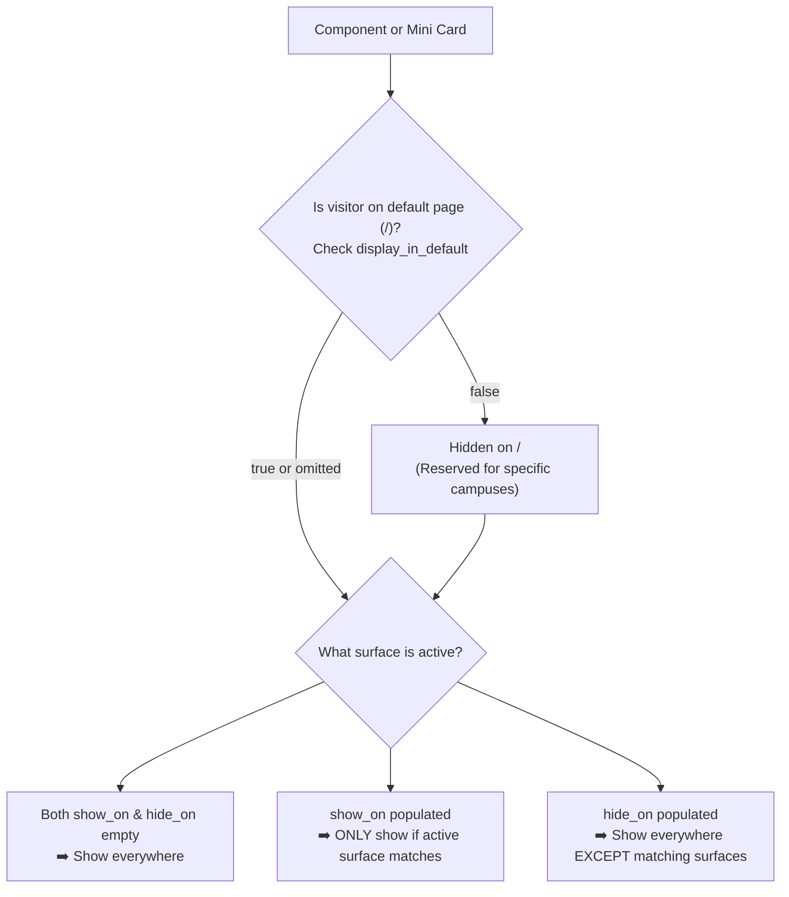

# Storyblok Starter Setup Guide — link-tree

This is the comprehensive, step-by-step setup guide for creating, configuring, and maintaining the **Echo Link-Tree** in Storyblok.

It is written for anyone who has **never used Storyblok before**, adheres strictly to the **Storyblok Starter (Free) plan** (1 editor seat, 0 extra costs), and documents every single component, field, reason, type, default, and surface rule.

> **Important**: Storyblok often starts a new space with a temporary paid trial. This guide intentionally uses only permanent features available on the free Starter plan so that your site continues working reliably after the trial expires.

---

## 0. What this project is doing

Storyblok functions as the **headless Content Management System (CMS)**.

The website itself is compiled by **Eleventy (11ty)** into pure, lightning-fast static HTML/CSS files. Storyblok delivers the raw content: church name, profile bio, action buttons, service times, images, videos, groups, and legal footer info.

### Architectural Core Principles
1. **Static-First**: Content is fetched from Storyblok during the build. Regular visitors receive instant static HTML without running heavy CMS JavaScript.
2. **Privacy-First (GDPR / DSGVO)**: Zero tracking cookies, zero external fonts (all fonts are hosted locally), and zero initial third-party connections. No cookie banner is required on initial visit.
3. **2-Click YouTube Consent**: YouTube videos load a local/uploaded thumbnail first. An embed iframe is only created after an explicit user click on the play button, using YouTube Privacy-Enhanced Mode (`youtube-nocookie.com`).
4. **Brand Color Constancy**: Brand colors remain strictly invariant across all routes and views. City switches and surfaces filter content visibility only; they never alter brand styling or colors.
5. **Dual-Tier Curation**:
   - **Tier 1 (`display_in_default`)**: Curates the main landing page (`/`) independently.
   - **Tier 2 (`show_on` / `hide_on`)**: Targets components to specific campus routes (`gifhorn`, `wolfsburg`, `helmstedt`, `instagram`).

The technical blueprint is declared in:
[`storyblok/components.json`](file:///Users/Shared/projeckt/goto/link-tree/storyblok/components.json)

---

# PART A — Create the Storyblok Space

## Step 1 — Create or sign in to Storyblok
1. Open [storyblok.com](https://www.storyblok.com).
2. Sign in or create a free account.
3. Use the primary email that will manage the church's web links.
4. Keep the space to **one editor seat** to remain comfortably within the free tier.

## Step 2 — Create one Space
A **Space** is Storyblok's term for a project.
1. From the Storyblok dashboard, click **Create new space**.
2. Space Name: `Echo Link-Tree` (or your church/organization name).
3. Server Location / Region: Choose **EU** (Frankfurt) for optimal latency and DSGVO data residency.
4. Click **Create space**.

> **One Space Rule**: Use this **single space** for your entire church link ecosystem. Do not create separate spaces for Gifhorn, Wolfsburg, Helmstedt, or Instagram. Those are handled via **Surfaces** inside this one space.

## Step 3 — Stay compatible with Starter Free
To avoid unexpected charges or breaking after the trial period:
- ✅ **Use**: 1 Space, Content Delivery API, Visual Editor, Nestable Components, Assets, Datasources, Webhooks.
- ❌ **Do NOT use**: Storyblok Agents, paid SEO Meta Tags app, custom roles, multi-stage workflows, releases, pipelines, or GraphQL.

---

# PART B — Create the Access Tokens

## Step 4 — Create a Public Content Delivery token
Used by the production static build (e.g. on Netlify) to fetch **published** content.
1. In your Storyblok space, go to **Settings** (gear icon in the sidebar).
2. Click **Access Tokens**.
3. Click **New Access Token**.
4. Name: `Netlify Production`
5. Type: Select **Public** (Access: Read published content).
6. Click **Generate Token** and copy it safely.

## Step 5 — Create a Preview token (Optional for Visual Editor)
Used by local development and the Visual Editor to preview **draft** unpublished content.
1. Click **New Access Token**.
2. Name: `Visual Editor Preview`
3. Type: Select **Preview** (Access: Read draft & published content).
4. Click **Generate Token**.

---

# PART C — Create & Manage the Reusable Surfaces Datasource

## What is a Surface?
A **Surface** represents a target channel, audience, or campus location.
Instead of building separate websites for Gifhorn, Wolfsburg, Helmstedt, or Instagram, the site generates dedicated static routes from the same content tree:
- `/` → Default main landing page (for universal visitors)
- `/gf/` and `/gifhorn/` → Gifhorn campus visitors
- `/wob/` and `/wolfsburg/` → Wolfsburg campus visitors
- `/he/` and `/helmstedt/` → Helmstedt campus visitors
- `/ig/` and `/instagram/` → Instagram bio traffic
- `/test/` → Interactive preview page with a live surface switcher

A Storyblok **Datasource** is a centralized, reusable list of key-value pairs. Using a datasource ensures that campus names and slugs are managed in one place and reused across all components.

## Step 6 — Create the Surfaces Datasource
1. In Storyblok, click **Datasources** in the left navigation.
2. Click **New Datasource**.
3. Name: `Surfaces`
4. Slug: `surfaces`
5. Click **Save**.

## Step 7 — Add the Standard Surface Entries
Click **Add Entry** and populate each row with the exact values below:

| Name (Display in Editor) | Value (Technical Slug) | Route Mapped | Purpose / Usage |
|---|---|---|---|
| `Default` | `default` | `/` | Standard landing page; universal links. |
| `Gifhorn (gf)` | `gifhorn` | `/gf/` & `/gifhorn/` | Gifhorn campus services & announcements. |
| `Wolfsburg (wob)` | `wolfsburg` | `/wob/` & `/wolfsburg/` | Wolfsburg campus services & announcements. |
| `Helmstedt (he)` | `helmstedt` | `/he/` & `/helmstedt/` | Helmstedt campus services & announcements. |
| `Instagram (ig)` | `instagram` | `/ig/` & `/instagram/` | Instagram bio links & social campaigns. |
| `TikTok` | `tiktok` | `?surface=tiktok` | TikTok bio campaigns. |
| `LinkedIn` | `linkedin` | `?surface=linkedin` | Professional/team content. |
| `YouTube` | `youtube` | `?surface=youtube` | Livestream/broadcast viewers. |

## Step 8 — How to Manage Surfaces Over Time

### Adding a New Surface
If you want to target a new campaign (e.g. *Easter Conference* or a *QR Code on a printed flyer*):
1. Open **Datasources → Surfaces**.
2. Click **Add Entry**.
3. **Name**: Enter a friendly label for editors (e.g. `Easter Conference (easter)` or `Printed Flyer (flyer)`).
4. **Value**: Enter a clean lowercase slug without spaces (e.g. `easter` or `flyer`).
5. Click **Save**.
6. The new option immediately appears in the `show_on` and `hide_on` dropdowns of all components!

### Slugs vs. Code Routes
- **Slugs (`value`)**: Must match lowercase alphanumeric letters and dashes.
- Visitors can view the surface dynamically on any page by adding the query parameter: `?surface=easter` or `?switch=easter`.
- If you later want a permanent static shortcut like `<domain>/easter/`, add that route to `src/_data/surfaces.js` in the repository.

### Renaming or Removing an Entry
- **Renaming the Name**: Safe at any time. It only changes what editors see in dropdown menus.
- **Changing the Value (Slug)**: ⚠️ Caution! If existing components were tagged with the old slug, update those components to use the new slug.

---

# PART D — Understanding show_on, hide_on & display_in_default

Every component in the system includes three targeting controls:

### The Rules Explained

#### 1. `display_in_default` (Boolean Switch)
- **Type**: `Boolean`
- **Default**: `true`
- **Reason**: Allows you to curate the default homepage (`/`) independently.
- **Rule**:
  - `true`: The item appears on the main homepage (`/`).
  - `false`: The item is hidden from `/`, allowing you to reserve location-specific items (like city switch buttons or specific campus photos) exclusively for their respective pages (`/gf`, `/wob`, `/he`).

#### 2. `show_on` (Allowlist)
- **Type**: `Multi-Option` (Storyblok `options`)
- **Source**: `surfaces` Datasource
- **Default**: Empty `[]`
- **Reason**: Restricts an item so it **ONLY** appears on selected surfaces.
- **Example**: A button set to `show_on = ["gifhorn"]` will only appear on `/gf` and `/gifhorn`.

#### 3. `hide_on` (Blocklist)
- **Type**: `Multi-Option` (Storyblok `options`)
- **Source**: `surfaces` Datasource
- **Default**: Empty `[]`
- **Reason**: Hides an item on selected surfaces while displaying it everywhere else.
- **Example**: A button set to `hide_on = ["instagram"]` displays on `/`, `/gf`, `/wob`, and `/he`, but is hidden for Instagram visitors.

> **Golden Rule for Editors**:
> - **Want an item everywhere?** Leave both `show_on` and `hide_on` empty.
> - **Want an item on 1 or 2 specific campuses?** Select them in `show_on`, leave `hide_on` empty, and set `display_in_default = false`.
> - **Want an item everywhere except one?** Select that one in `hide_on` and leave `show_on` empty.
> - **Avoid filling both `show_on` and `hide_on` on the same item.**

---

# PART E — Component Reference: All 12 Components

Below is the complete reference for every component in the system. When creating components manually in Storyblok (**Block Library → Components**), ensure all technical names and field types match exactly.

---

## 1. Content Type: `link_page` (Page Root)

The root document for a link tree page.

- **Technical Name**: `link_page`
- **Display Name**: `Link Page`
- **Component Type**: **Content Type** (Root)

### Fields

| Field Name | Display Name | Reason / Purpose | Type | Default Value | Required | Editor Guidance |
|---|---|---|---|---|---|---|
| `title` | Page Title | Sets the browser title and SEO meta tag. | `Text` | `Echo Kirche` | **Yes** | e.g. `Echo Kirche — Links & Infos` |
| `theme` | Color Theme | Selects the brand theme preset. | `Single Option` | `light` | No | Options: `light`, `pale`, `soft`, `dark`, `teal`, `lavender`. |
| `surface` | Target Surface | Default surface for this page story. | `Single Option` | `default` | No | Source: `surfaces` datasource. |
| `profile` | Profile Header | Holds the avatar, name, and bio header block. | `Blocks` | None | No | Restrict to: `profile_header`. Max: 1 block. |
| `body` | Main Content | The main ordered list of links, cards, and groups. | `Blocks` | None | No | Restrict to: `group_block`, `link_button`, `dropdown_card`, `image_card_horizontal`, `image_card_vertical`, `video_link_card`, `section_heading`. Drag to reorder! |
| `footer` | Legal Footer | Legal info, address, impressum, and social icons. | `Blocks` | None | No | Restrict to: `footer_legal`. Max: 1 block. |
| `seo_title` | SEO Title | Overrides the browser title tag for search engines. | `Text` | Empty | No | Optional. |
| `seo_description` | Meta Description | Summary text displayed in search results and embeds. | `Textarea` | Empty | No | Keep under 160 characters. |
| `social_image` | Social Share Image | Open Graph image for link previews on WhatsApp/iMessage. | `Asset` (Images) | None | No | Recommended: 1200×630 px. |
| `canonical_url` | Canonical URL | Preferred URL for search engine indexing. | `Link` or `Text` | Empty | No | e.g. `https://kirche-echo.de` |
| `noindex` | Hide from Search | Prevents search engine indexing. | `Boolean` | `false` | No | Leave false unless page is private/internal. |

---

## 2. Nestable Block: `profile_header` (Header & Avatar)

Displays the church avatar/logo, name, and bio tagline at the top of the page.

- **Technical Name**: `profile_header`
- **Display Name**: `Profile Header`
- **Component Type**: **Nestable Block**

### Fields

| Field Name | Display Name | Reason / Purpose | Type | Default Value | Required | Editor Guidance |
|---|---|---|---|---|---|---|
| `name` | Name | The primary organization or church name. | `Text` | `Echo Kirche` | **Yes** | Displayed as heading under the avatar. |
| `bio` | Bio / Tagline | Short mission statement or welcome message. | `Textarea` | Empty | No | Keep under 120 characters. Leave empty if you only want the title. |
| `avatar` | Avatar / Logo | Vector logo or profile image. | `Asset` (Images) | None | No | SVG, WebP, or PNG (square 1:1 format recommended). |

---

## 3. Nestable Block: `link_button` (Standard Action Button)

A full-width, prominent clickable button for links to websites, sign-ups, or donation forms.

- **Technical Name**: `link_button`
- **Display Name**: `Link Button`
- **Component Type**: **Nestable Block**

### Fields

| Field Name | Display Name | Reason / Purpose | Type | Default Value | Required | Editor Guidance |
|---|---|---|---|---|---|---|
| `label` | Button Text | The text displayed prominently on the button. | `Text` | None | **Yes** | e.g. `Website besuchen` or `Spenden & Unterstützen`. |
| `url` | Destination URL | The target web address. | `Link` or `Text` | None | **Yes** | e.g. `https://kirche-echo.de/spenden`. |
| `icon` | Icon | Accompanying visual symbol on the left. | `Single Option` | `""` (None) | No | Supported: `church`, `calendar`, `video`, `heart`, `users`, `location`, `music`, `newsletter`, `podcast`, `envelope`, `globe`, `logo`, `link`. |
| `display_in_default` | Display on Default | Controls visibility on the main landing page (`/`). | `Boolean` | `true` | No | Set to `false` for campus-specific buttons (e.g. Gifhorn switch). |
| `show_on` | Show On | Allowlist: only show on these specific surfaces. | `Multi-Option` | `[]` | No | Source: `surfaces` datasource. |
| `hide_on` | Hide On | Blocklist: hide on these specific surfaces. | `Multi-Option` | `[]` | No | Source: `surfaces` datasource. |

---

## 4. Nestable Block: `dropdown_card` (Collapsible Service Times Card)

An interactive, pure-CSS collapsible card for service times and campus schedules. On click, it smoothly expands to reveal a responsive 3-column auto-fit grid. Centered button label and church icon.

- **Technical Name**: `dropdown_card`
- **Display Name**: `Dropdown Service Times Card`
- **Component Type**: **Nestable Block**

### Fields

| Field Name | Display Name | Reason / Purpose | Type | Default Value | Required | Editor Guidance |
|---|---|---|---|---|---|---|
| `label` | Card Header Label | The text on the expandable button. | `Text` | `Gottesdienste & Zeiten` | **Yes** | Centered in the summary bar. |
| `icon` | Icon | Visual icon displayed in the summary bar. | `Single Option` | `church` | No | Default: `church`. |
| `description` | Introductory Text | Text shown right beneath the button when expanded. | `Text` | `Feiere mit uns vor Ort in Gifhorn, Wolfsburg und Helmstedt...` | No | Explains options or online stream. |
| `display_in_default` | Display on Default | Controls visibility on the main landing page (`/`). | `Boolean` | `true` | No | Default `true` displays the card on `/`. |
| `layout` | Layout Mode | Grid display format for child items. | `Single Option` | `columns` | No | Options: `columns` (responsive 3-column grid) or `list` (single vertical list). |
| `locations` | Active Locations | Selection of locations included in this card. | `Multi-Option` | `["gifhorn", "wolfsburg", "helmstedt"]` | No | Options: `gifhorn`, `wolfsburg`, `helmstedt`, `instagram`. |
| `times` | Location Columns | The individual mini cards for each service or campus. | `Blocks` | None | No | Restrict to: `dropdown_time_item`. |
| `url` | Footer Action URL | Link destination for the bottom action button. | `Text` or `Link` | `https://kirche-echo.de` | No | Links to full church locations overview. |
| `action_label` | Action Button Text | Label for the bottom action button. | `Text` | `Alle Standorte & Livestream ansehen →` | No | Text on the bottom full-width link. |
| `show_on` | Show On | Surface allowlist. | `Multi-Option` | `[]` | No | Source: `surfaces` datasource. |
| `hide_on` | Hide On | Surface blocklist. | `Multi-Option` | `[]` | No | Source: `surfaces` datasource. |

---

## 5. Nestable Block: `dropdown_time_item` (Service Time Mini Card)

An individual campus or service mini card inside the `dropdown_card`. Every single element is 100% editable and customizable.

- **Technical Name**: `dropdown_time_item`
- **Display Name**: `Dropdown Service Time / Location Column`
- **Component Type**: **Nestable Block**

### Fields

| Field Name | Display Name | Reason / Purpose | Type | Default Value | Required | Editor Guidance |
|---|---|---|---|---|---|---|
| `title` | Location / Service Title | The heading of this specific card. | `Text` | None | **Yes** | e.g. `Gifhorn (10:00)`, `Gifhorn (12:00)`, `Wolfsburg`, `Helmstedt`. |
| `time` | Time Badge | Highlighted time badge at the top. | `Text` | None | **Yes** | e.g. `10:00 Uhr`, `11:00 Uhr`, `12:00 Uhr`. |
| `location` | Venue / Room | Specific hall, campus, or address. | `Text` | Empty | No | e.g. `BSK-Saal, Schützenplatz 3`. |
| `details` | Details / Description | Additional notes (e.g. room info, parking). | `Textarea` | Empty | No | e.g. `Unsere Gottesdienste finden jeden Sonntag um 10:00 und 12:00 Uhr nebenan im BSK-Saal statt.` |
| `display_in_default` | Display on Default | Controls visibility on the main landing page (`/`). | `Boolean` | `true` | No | Set to `true` to include in default 3-column overview. |
| `has_kids` | Echo Kids Available | Toggles the tiny kid icon badge. | `Boolean` | `true` | No | Check to display the child SVG icon indicating children's church. |
| `kids_label` | Echo Kids Label | Text next to the tiny kid icon. | `Text` | `Echo Kids verfügbar` | No | Customize if needed (e.g. `Kids Church ab 3 Jahren`). |
| `url` | Campus Link URL | Link directly to this location's web page. | `Text` or `Link` | Empty | No | e.g. `https://kirche-echo.de/gifhorn`. |
| `action_label` | Link Label | Text on the mini card's link button. | `Text` | `Standort & Infos →` | No | e.g. `Standort Gifhorn →`. |
| `show_on` | Show On | Surface allowlist. | `Multi-Option` | `[]` | No | Set to `gifhorn` for Gifhorn services. |
| `hide_on` | Hide On | Surface blocklist. | `Multi-Option` | `[]` | No | Source: `surfaces` datasource. |

---

## 6. Nestable Block: `image_card_horizontal` (16:9 Featured Card)

A landscape media card with a 16:9 image, headline, and interactive arrow button. Ideal for current sermon series, conferences, or campaigns.

- **Technical Name**: `image_card_horizontal`
- **Display Name**: `Horizontal Image Card`
- **Component Type**: **Nestable Block**

### Fields

| Field Name | Display Name | Reason / Purpose | Type | Default Value | Required | Editor Guidance |
|---|---|---|---|---|---|---|
| `label` | Headline | Title text displayed below the image. | `Text` | None | **Yes** | e.g. `Aktuelle Predigtreihe: Hoffnung`. |
| `url` | Destination URL | Target web address. | `Link` or `Text` | None | **Yes** | e.g. `https://kirche-echo.de/predigten`. |
| `image` | 16:9 Image Asset | Landscape image. | `Asset` (Images) | None | **Yes** | Recommended: 1200×675 px or 1280×720 px. |
| `display_in_default` | Display on Default | Controls visibility on the main landing page (`/`). | `Boolean` | `true` | No | Set to `false` if image is for a specific city only. |
| `show_on` | Show On | Surface allowlist. | `Multi-Option` | `[]` | No | Source: `surfaces` datasource. |
| `hide_on` | Hide On | Surface blocklist. | `Multi-Option` | `[]` | No | Source: `surfaces` datasource. |

---

## 7. Nestable Block: `image_card_vertical` (3:4 Portrait Flyer)

A portrait media card in 3:4 aspect ratio. Perfect for event posters, flyers, or speaker announcements.

- **Technical Name**: `image_card_vertical`
- **Display Name**: `Vertical Image Card`
- **Component Type**: **Nestable Block**

### Fields

| Field Name | Display Name | Reason / Purpose | Type | Default Value | Required | Editor Guidance |
|---|---|---|---|---|---|---|
| `label` | Title | Text label beneath the flyer. | `Text` | None | **Yes** | e.g. `Echo Jugend Konferenz 2026`. |
| `url` | Destination URL | Target address. | `Link` or `Text` | None | **Yes** | e.g. `https://kirche-echo.de/events`. |
| `image` | 3:4 Image Asset | Portrait flyer image. | `Asset` (Images) | None | **Yes** | Recommended: 900×1200 px. |
| `display_in_default` | Display on Default | Controls visibility on the main landing page (`/`). | `Boolean` | `true` | No | Default `true`. |
| `show_on` | Show On | Surface allowlist. | `Multi-Option` | `[]` | No | Source: `surfaces` datasource. |
| `hide_on` | Hide On | Surface blocklist. | `Multi-Option` | `[]` | No | Source: `surfaces` datasource. |

---

## 8. Nestable Block: `video_link_card` (Privacy 2-Click Video Card)

A GDPR-compliant video card. Displays a preview image with a centered play button. No YouTube cookies or iframes load until the visitor explicitly clicks play.

- **Technical Name**: `video_link_card`
- **Display Name**: `Video Card`
- **Component Type**: **Nestable Block**

### Fields

| Field Name | Display Name | Reason / Purpose | Type | Default Value | Required | Editor Guidance |
|---|---|---|---|---|---|---|
| `label` | Video Title | The headline of the video. | `Text` | None | **Yes** | e.g. `Letzter Gottesdienst im Livestream`. |
| `provider` | Video Provider | Selects the video platform. | `Single Option` | `youtube` | **Yes** | Options: `youtube` or `other` (Vimeo). |
| `youtube_video_id` | YouTube Video ID | The unique YouTube identifier. | `Text` | Empty | No | Enter **only the Video ID** (e.g. `NsZVWivPeHk` or `M7lc1UVf-VE`). The system also auto-extracts the ID if a full watch URL is pasted! |
| `youtube_content_type`| Content Type | Presentation hint for live vs recorded. | `Single Option` | `video` | No | Options: `video` (normal video) or `live` (scheduled / active livestream). |
| `url` | Other Video URL | Target URL for non-YouTube providers. | `Text` | Empty | No | Only use when Provider = `other`. Leave empty for YouTube. |
| `image` | Preview Thumbnail | Local preview image before user clicks play. | `Asset` (Images) | None | **Yes** | Upload 16:9 thumbnail to Storyblok. |
| `display_in_default` | Display on Default | Controls visibility on the main landing page (`/`). | `Boolean` | `true` | No | Default `true`. |
| `show_on` | Show On | Surface allowlist. | `Multi-Option` | `[]` | No | Source: `surfaces` datasource. |
| `hide_on` | Hide On | Surface blocklist. | `Multi-Option` | `[]` | No | Source: `surfaces` datasource. |

---

## 9. Nestable Block: `section_heading` (Category Divider)

A clean uppercase section heading used to visually divide content categories (e.g. *Gottesdienste*, *Medien & Musik*, *Gemeinde*).

- **Technical Name**: `section_heading`
- **Display Name**: `Section Heading`
- **Component Type**: **Nestable Block**

### Fields

| Field Name | Display Name | Reason / Purpose | Type | Default Value | Required | Editor Guidance |
|---|---|---|---|---|---|---|
| `title` | Heading Text | The text of the category divider. | `Text` | None | **Yes** | e.g. `Medien & Musik` or `Unsere Standorte`. |
| `display_in_default` | Display on Default | Controls visibility on the main landing page (`/`). | `Boolean` | `true` | No | Default `true`. |

---

## 10. Nestable Block: `group_block` (Container Box)

A styled container box that groups related buttons, dropdown cards, or media cards into a cohesive visual card.

- **Technical Name**: `group_block`
- **Display Name**: `Group Block`
- **Component Type**: **Nestable Block**

### Fields

| Field Name | Display Name | Reason / Purpose | Type | Default Value | Required | Editor Guidance |
|---|---|---|---|---|---|---|
| `title` | Group Title | Optional header above the grouped items. | `Text` | Empty | No | e.g. `Unsere Standorte`. |
| `description` | Group Description | Optional short explanation text. | `Textarea` | Empty | No | e.g. `Finde die Echo Kirche in deiner Nähe.` |
| `variant` | Visual Style | Container background and border treatment. | `Single Option` | `card` | No | Options: `card` (white card with soft shadow), `soft` (tinted background), `outline` (dashed border), `transparent` (borderless list). |
| `items` | Nested Items | The list of buttons and cards inside the box. | `Blocks` | None | No | Restrict to: `link_button`, `dropdown_card`, `image_card_horizontal`, `image_card_vertical`, `video_link_card`, `section_heading`. |
| `display_in_default` | Display on Default | Controls visibility on the main landing page (`/`). | `Boolean` | `true` | No | Default `true`. |
| `show_on` | Show On | Surface allowlist. | `Multi-Option` | `[]` | No | Source: `surfaces` datasource. |
| `hide_on` | Hide On | Surface blocklist. | `Multi-Option` | `[]` | No | Source: `surfaces` datasource. |

---

## 11. Nestable Block: `social_item` (Social Media Button)

A circular icon button for external social profiles (Instagram, WhatsApp, YouTube, Spotify, etc.) located in the footer.

- **Technical Name**: `social_item`
- **Display Name**: `Social Item`
- **Component Type**: **Nestable Block**

### Fields

| Field Name | Display Name | Reason / Purpose | Type | Default Value | Required | Editor Guidance |
|---|---|---|---|---|---|---|
| `platform` | Platform | Selects the social platform and SVG icon. | `Single Option` | None | **Yes** | Options: `instagram`, `whatsapp`, `youtube`, `spotify`, `email`, `website`, `facebook`, `tiktok`, `linkedin`. |
| `url` | Profile URL | Target profile web address or mailto link. | `Link` or `Text` | None | **Yes** | e.g. `https://instagram.com/kirche.echo`. For email use `mailto:info@kirche-echo.de`. |
| `label` | Accessibility Label | Screen-reader text for accessibility. | `Text` | Empty | No | e.g. `Instagram — Echo Kirche`. |

---

## 12. Nestable Block: `footer_legal` (Legal & Contact Information)

The bottom footer section containing organization address, mandatory German legal links (Impressum & Datenschutz), copyright year, and social buttons.

- **Technical Name**: `footer_legal`
- **Display Name**: `Footer Legal`
- **Component Type**: **Nestable Block**

### Fields

| Field Name | Display Name | Reason / Purpose | Type | Default Value | Required | Editor Guidance |
|---|---|---|---|---|---|---|
| `organization_name` | Organization Name | Official registered name of the church/association. | `Text` | `Kirche im Brauhaus e.V.` | No | e.g. `Kirche im Brauhaus e.V.`. |
| `street` | Street Address | Registered street address. | `Text` | `Schützenplatz 1` | No | e.g. `Schützenplatz 1`. |
| `city` | Postal Code & City | City and postal code. | `Text` | `38518 Gifhorn` | No | e.g. `38518 Gifhorn`. |
| `email` | Contact E-Mail | Official contact email. | `Text` | `info@kirche-echo.de` | No | e.g. `info@kirche-echo.de`. |
| `impressum_url` | Impressum URL | Mandatory link to legal imprint (DDG/TMG). | `Link` or `Text` | `/impressum/` | No | Local static route: `/impressum/`. |
| `datenschutz_url` | Datenschutz URL | Mandatory link to privacy policy (DSGVO). | `Link` or `Text` | `/datenschutz/` | No | Local static route: `/datenschutz/`. |
| `copyright_year` | Copyright Year | Year shown in copyright notice. | `Text` | `2026` | No | Current year (e.g. `2026`). |
| `socials` | Social Icons | List of circular social media buttons. | `Blocks` | None | No | Restrict to: `social_item`. |

---

# PART F — Step-by-Step: Adding Campus Content in Storyblok

Here is how an editor configures the actual Echo Church campus schedules:

### 1. Setting up Gifhorn (`/gf` & `/gifhorn`)
In Gifhorn, services are held at 10:00 and 12:00 in the BSK-Saal, and Echo Kids is available:
1. Open the `Home` story in Storyblok.
2. In the `body`, find the `dropdown_card` (*Gottesdienste & Zeiten*).
3. Under **Location Columns** (`times`), add two `dropdown_time_item` blocks:
   - **Card 1 (10:00 Uhr)**:
     - `title`: `Gifhorn (10:00)`
     - `time`: `10:00 Uhr`
     - `location`: `BSK-Saal, Schützenplatz 3`
     - `details`: `Unsere Gottesdienste finden jeden Sonntag um 10:00 und 12:00 Uhr nebenan im BSK-Saal, Schützenplatz 3 statt.`
     - `display_in_default`: `true`
     - `has_kids`: `true` (checked)
     - `kids_label`: `Echo Kids verfügbar`
     - `url`: `https://kirche-echo.de/gifhorn`
     - `show_on`: Select `Gifhorn (gf)`
   - **Card 2 (12:00 Uhr)**:
     - `title`: `Gifhorn (12:00)`
     - `time`: `12:00 Uhr`
     - `location`: `BSK-Saal, Schützenplatz 3`
     - `details`: `Unsere Gottesdienste finden jeden Sonntag um 10:00 und 12:00 Uhr nebenan im BSK-Saal, Schützenplatz 3 statt.`
     - `display_in_default`: `true`
     - `has_kids`: `true` (checked)
     - `kids_label`: `Echo Kids verfügbar`
     - `url`: `https://kirche-echo.de/gifhorn`
     - `show_on`: Select `Gifhorn (gf)`

### 2. Setting up Wolfsburg (`/wob` & `/wolfsburg`)
1. Under `times`, add another `dropdown_time_item`:
   - `title`: `Wolfsburg`
   - `time`: `11:00 Uhr`
   - `location`: `Standort Wolfsburg`
   - `display_in_default`: `true`
   - `has_kids`: `true` (checked)
   - `kids_label`: `Echo Kids verfügbar`
   - `url`: `https://kirche-echo.de/wolfsburg`
   - `show_on`: Select `Wolfsburg (wob)`

### 3. Setting up Helmstedt (`/he` & `/helmstedt`)
1. Under `times`, add another `dropdown_time_item`:
   - `title`: `Helmstedt`
   - `time`: `12:00 Uhr`
   - `location`: `Standort Helmstedt`
   - `display_in_default`: `true`
   - `has_kids`: `false` (unchecked)
   - `url`: `https://kirche-echo.de/helmstedt`
   - `show_on`: Select `Helmstedt (he)`

### 4. Setting up City-Specific Photos & Buttons
- **Gifhorn Hero Photo**:
  - Add `image_card_horizontal` with the Gifhorn image.
  - Set `display_in_default = false` (so it does not clutter the main landing page `/`).
  - Set `show_on = ["gifhorn"]` (so it appears only on `/gf` and `/gifhorn`).
- **Default Sermons / General Links**:
  - Set `display_in_default = true`.
  - Leave `show_on` empty (so it appears everywhere).

---

# PART G — Previewing and Testing Your Surfaces

The website provides an **Interactive Test Suite & Surface Switcher**:
1. Open your browser to `/test` (e.g. `https://your-site.netlify.app/test/` or `http://localhost:8080/test/`).
2. You will see a clean test toolbar at the top with buttons:
   - **All** (shows every block without filtering)
   - **Default** (shows only default landing page content)
   - **Gifhorn** (previews `/gf`)
   - **Wolfsburg** (previews `/wob`)
   - **Helmstedt** (previews `/he`)
   - **Instagram** (previews `/ig`)
3. Click between them to test your filtering live before publishing to production!

---

# PART H — Netlify Environment Variables & Webhook Rebuilds

## Netlify Environment Variables
In Netlify (**Site Configuration → Environment Variables**):
- `STORYBLOK_TOKEN`: Your **Public** access token.
- `STORYBLOK_VERSION`: `published`
- `STORYBLOK_SLUG`: `home`

For preview/development builds:
- `STORYBLOK_VERSION`: `draft`

## Automatic Rebuild on Publish
To have Netlify automatically rebuild and publish your site whenever an editor clicks **Publish** in Storyblok:
1. In Netlify: Go to **Build & Deploy → Continuous Deployment → Build hooks**.
2. Click **Add build hook**.
3. Name: `Storyblok Publish`, Branch: `master`.
4. Copy the generated webhook URL.
5. In Storyblok: Go to **Settings → Webhooks**.
6. Click **New Webhook**.
7. Name: `Netlify Deploy`.
8. Webhook URL: Paste the Netlify build hook URL.
9. Event: Check **Story published** and **Story unpublished**.
10. Click **Save**.

Now, whenever you publish changes in Storyblok, Netlify automatically compiles and updates your live website in seconds!

---

# PART I — Setup Verification Checklist

Your Storyblok space and project setup is complete when all of the following are verified:

- [ ] Single Storyblok space created in EU region.
- [ ] Public access token added to Netlify environment variables (`STORYBLOK_TOKEN`).
- [ ] `Surfaces` datasource created with entries: `default`, `gifhorn`, `wolfsburg`, `helmstedt`, `instagram`, `tiktok`, `linkedin`, `youtube`.
- [ ] All 12 components created with exact technical names:
  - [ ] `link_page` (Content Type)
  - [ ] `profile_header` (Nestable Block)
  - [ ] `link_button` (Nestable Block)
  - [ ] `dropdown_card` (Nestable Block)
  - [ ] `dropdown_time_item` (Nestable Block)
  - [ ] `image_card_horizontal` (Nestable Block)
  - [ ] `image_card_vertical` (Nestable Block)
  - [ ] `video_link_card` (Nestable Block)
  - [ ] `section_heading` (Nestable Block)
  - [ ] `group_block` (Nestable Block)
  - [ ] `social_item` (Nestable Block)
  - [ ] `footer_legal` (Nestable Block)
- [ ] `Home` story created with slug `home`.
- [ ] Service times configured in `dropdown_card` (Gifhorn 10:00 & 12:00 in BSK-Saal with Echo Kids, Wolfsburg 11:00, Helmstedt 12:00).
- [ ] Campus-specific items have `display_in_default = false` and appropriate `show_on` values.
- [ ] Netlify build hook connected to Storyblok publish webhook.
- [ ] Tested `/test` route with live surface switcher.
- [ ] Zero cookies on initial load, zero third-party fonts, zero initial iframes.
