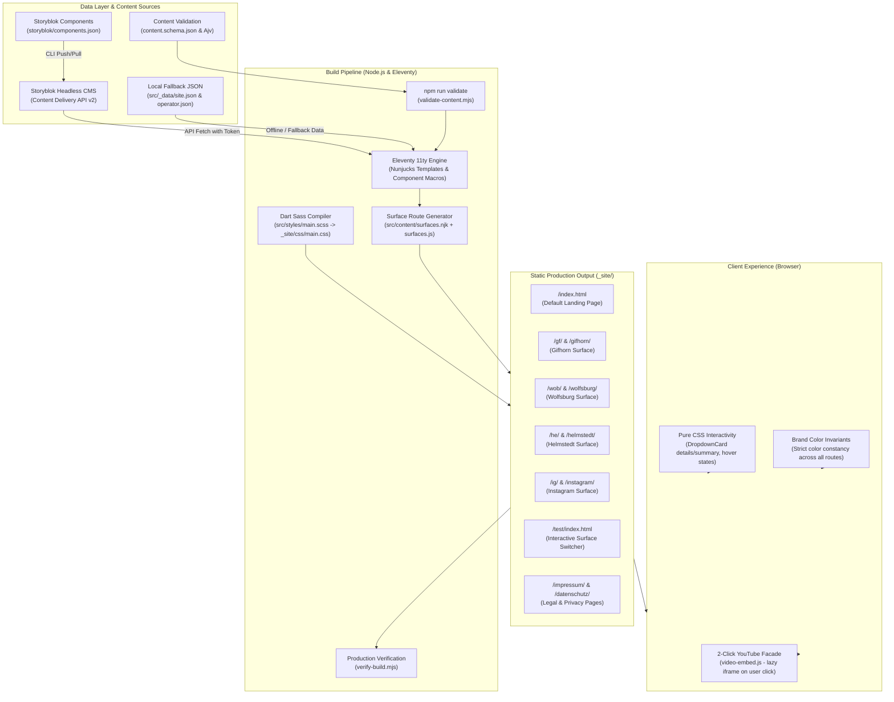

# System Architecture & Technical Specification

## 1. Executive Summary

`link-tree` is a static-first, headless CMS-driven link-in-bio platform engineered for:
1. **Sub-second static performance**: 100% pre-rendered HTML via Eleventy (11ty) and a single compressed CSS file generated with Dart Sass. Zero JavaScript hydration.
2. **Strict privacy by default (GDPR/DSGVO compliant)**: Zero client-side tracking, zero third-party fonts, zero initial third-party connections, and a privacy-first 2-click consent facade for YouTube video embeds.
3. **Multi-surface targeting**: Clean, dedicated static routes (`/`, `/gf`, `/wob`, `/he`, `/ig`, `/test`) generated at build time with canonical 301 redirects, preserving brand color constancy.
4. **Dual-tier content curation**: Granular control via `displayInDefault` / `display_in_default` (curating the default landing page independently) alongside `showOn` / `hideOn` surface filtering.
5. **Headless Storyblok integration**: Live in-browser visual editing via Storyblok's Visual Editor bridge during preview, paired with an offline JSON fallback (`src/_data/site.json`) and Storyblok CLI component synchronization.

---

## 2. High-Level Architecture Diagram



---

## 3. Technology Stack

| Layer | Technology | Rationale & Architectural Constraints |
|---|---|---|
| **Static Site Generator** | Eleventy (11ty) v3.x | Pre-renders all routes to clean HTML files. No client-side framework runtime (no React/Vue hydration overhead). |
| **Templating Engine** | Nunjucks | Component-based template rendering matching Storyblok blok schemas. Supports filters for surface filtering (`filterBySurface`). |
| **Styling & Design System** | Dart Sass / SCSS | Compiles down to a single minified CSS artifact (`_site/css/main.css`). CSS custom properties enforce semantic color tokens. |
| **Headless CMS** | Storyblok API v2 | Headless visual content editing for church editors. Provides visual editing bridge in preview mode; leaves production static. |
| **Schema Validation** | JSON Schema draft-07 + Ajv | Strictly validates local JSON data (`src/_data/site.json`) and Storyblok payload contracts before build. |
| **Deployment Target** | Netlify / Cloudflare Pages | Completely portable static hosting with zero serverless functions required. Enforces security headers via `netlify.toml` and `_headers`. |

---

## 4. Component Architecture & Hierarchy

All components are declared in `storyblok/components.json` and mirrored in `src/_includes/components/`:

```
link_page (Root Page)
├── profile_header (Logo avatar, church name, bio tagline)
├── body (Ordered list of content blocks)
│   ├── link_button (Full-width action button with optional icon)
│   ├── dropdown_card (Collapsible details/summary service times & locations)
│   │   └── dropdown_time_item (Mini cards: time badge, venue, Echo Kids badge, link)
│   ├── image_card_horizontal (16:9 featured horizontal card with title & arrow)
│   ├── image_card_vertical (3:4 portrait flyer card with title & arrow)
│   ├── video_link_card (Privacy 2-click video card with YouTube ID support)
│   ├── group_block (Container card grouping nested buttons or media cards)
│   └── section_heading (Uppercase category divider)
└── footer_legal (Organization details, Impressum/Datenschutz links, social buttons)
    └── social_item (Circular icon buttons for Instagram, YouTube, WhatsApp, etc.)
```

### 4.1 Component Details

#### `dropdown_card` & `dropdown_time_item`
- **Pure CSS Details/Summary**: Uses standard HTML5 `<details>` and `<summary>` elements with zero JavaScript.
- **Responsive 3-Column Grid**: Defaults to an auto-fit 3-column grid (`grid-template-columns: repeat(auto-fit, minmax(200px, 1fr))`) that stacks responsively on mobile.
- **100% Editable**: Every text element (`title`, `time`, `location`, `details`, `url`, `actionLabel`, `kidsLabel`) is customizable.
- **Echo Kids Indicator**: Built-in toggle (`hasKids` / `has_kids`) rendering a badge with an inline SVG child icon.

#### `video_link_card` (Privacy 2-Click YouTube Consent)
- **Zero initial third-party connections**: Thumbnail is rendered locally or statically. No YouTube iframes or Google tracking cookies load on page visit.
- **YouTube Video ID Model**: Takes standard YouTube IDs (`youtube_video_id`, e.g. `NsZVWivPeHk`) or full URLs. Supports normal videos and live broadcasts (`youtube_content_type: "live"`).
- **On-Demand Embed**: Clicking the play button dynamically mounts `https://www.youtube-nocookie.com/embed/VIDEO_ID?autoplay=1` via a lightweight helper (< 1.5 KB).

#### `group_block`
- Container component that wraps nested `link_button`, `dropdown_card`, `image_card_horizontal`, or `video_link_card` components within a styled card box (`card`, `soft`, `outline`, or `transparent`).

---

## 5. Dual-Tier Curation & Routing Architecture

### 5.1 Dual-Tier Curation Model

1. **Tier 1: Default Page Curation (`displayInDefault` / `display_in_default`)**
   - Boolean switch available on all components.
   - When `false`, the item is hidden from the main landing page (`/`), allowing editors to keep the main homepage clean and focused.
2. **Tier 2: Surface Targeting (`showOn` / `hideOn`)**
   - Multi-select field specifying which location/channel pages the item appears on (`gifhorn`, `wolfsburg`, `helmstedt`, `instagram`).
   - Items with `displayInDefault: false` and `showOn: ["gifhorn"]` will exclusively render on `/gf` and `/gifhorn`.

### 5.2 Static Surface Routes & Shortcuts

The site generates dedicated static HTML files at build time:

| Route Path | Canonical Surface | Purpose / Content Scope |
|---|---|---|
| `/` | `default` | Curated main page; city-specific switch buttons hidden; displays general church links and default service times. |
| `/gf/` & `/gifhorn/` | `gifhorn` | Gifhorn location landing page (2 Sunday services at 10:00 & 12:00 in BSK-Saal, Gifhorn hero photo). |
| `/wob/` & `/wolfsburg/` | `wolfsburg` | Wolfsburg location landing page (Sunday service at 11:00, Wolfsburg hero photo). |
| `/he/` & `/helmstedt/` | `helmstedt` | Helmstedt location landing page (Sunday service at 12:00, Helmstedt hero photo). |
| `/ig/` & `/instagram/` | `instagram` | Instagram bio traffic landing page. |
| `/test/` | `all` | Interactive test preview page containing the `.surface-switcher` toolbar to verify all surface filters live. |

### 5.3 Brand Color Invariant (Strict Rule)

**Brand colors must never change based on URL parameters, surfaces, or sublinks.**
- All city pages (`/gf`, `/wob`, `/he`), channel pages (`/ig`), and default routes share the identical canonical brand palette (`primary`, `primary-hover`, `surface`, `border`, `text`).
- URL parameters filter content visibility only; they never alter brand styling or token values.

---

## 6. Security & Privacy Guardrails

1. **Content Security Policy (CSP)**:
   - `default-src 'self'`
   - `script-src 'self' https://app.storyblok.com` (for Visual Editor preview)
   - `frame-ancestors 'self' https://app.storyblok.com` (enables Storyblok visual iframe)
   - `frame-src 'self' https://www.youtube-nocookie.com` (2-click video consent only)
   - `connect-src 'self' https://api.storyblok.com`
2. **Zero-Cookie Baseline**:
   - No tracking cookies, no Google Analytics, no Meta Pixel.
   - Requires no intrusive GDPR cookie banner on the standard landing page.
3. **Legal Compliance (Germany / EU)**:
   - Dedicated, permanent routes for `/impressum/` (Telemediengesetz / DDG) and `/datenschutz/` (GDPR / DSGVO).

---

## 7. Build & Verification Pipeline

```bash
# 1. Validate JSON data against schema
npm run validate

# 2. Compile and minify Sass design tokens and components
npm run build:sass

# 3. Static site compilation with Eleventy
npm run build:eleventy

# 4. Strict bundle size and output file verification
node scripts/verify-build.mjs

# 5. Run automated unit & integration test suites
npm test
```
