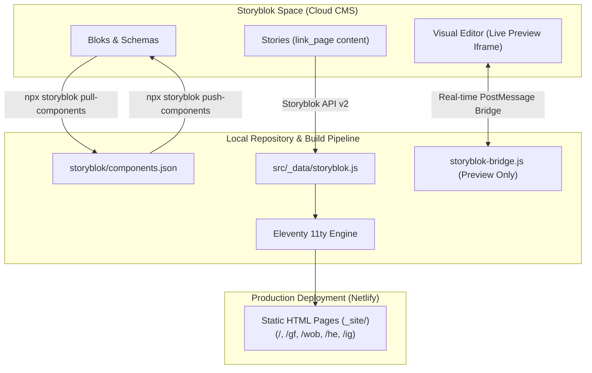

# Storyblok Headless CMS Integration & Component Guide
# Storyblok CMS Integration & Komponenten-Anleitung

This guide explains how to use Storyblok with this link-in-bio website. It contains complete instructions in **Simple English** and **Einfaches Deutsch** on how to create, configure, and fill each component in Storyblok.

Diese Anleitung erklärt die Pflege der Link-in-Bio-Website mit Storyblok. Sie enthält Schritt-für-Schritt-Anleitungen auf **Einfachem Deutsch** und **Simple English**, wie jede Komponente erstellt und ausgefüllt wird.

---

## 1. Architecture & Privacy Guarantees / Architektur & Datenschutz

- **Static-first**: The website builds into pure, lightning-fast static HTML.
- **Privacy-first**: Zero tracking cookies, zero external fonts (all fonts are local), and zero initial third-party connections.
- **Visual Editor**: The Storyblok live preview bridge only loads when an editor is actively previewing inside the Storyblok Visual Editor (`?_storyblok=...`). Visitors never load any Storyblok scripts.
- **Brand Colors**: Theme colors remain consistent across all pages and surfaces. URL parameters filter content without altering brand colors.



---

## 2. Component Synchronization / Komponenten synchronisieren

Component schemas are declared in [`storyblok/components.json`](file:///Users/Shared/projeckt/goto/link-tree/storyblok/components.json) for direct synchronization via the Storyblok CLI:

| Blok Component | Type | Description |
|---|---|---|
| `link_page` | Content Type | Root content type holding page title, theme (`light`, `pale`, `soft`, `dark`, `teal`, `lavender`), surface, `profile` blok, `body` bloks, and `footer` blok. |
| `profile_header` | Nestable Blok | Organization name, biography, and vector/raster avatar asset. |
| `group_block` | Nestable Blok | Container block with optional title, description, and style variant (`card`, `soft`, `outline`, `transparent`) that groups nested buttons, cards, and videos inside. |
| `link_button` | Nestable Blok | Label, URL, optional icon selection (`church`, `calendar`, `video`, `heart`, `users`, `location`, `music`, `newsletter`, `podcast`, `envelope`, `globe`, `logo`, `link`), and surface filtering rules (`show_on`, `hide_on`). |
| `dropdown_card` | Nestable Blok | Collapsible service times and locations card with responsive 3-column auto-fit grid and pure CSS details/summary state. |
| `dropdown_time_item` | Nestable Blok | Individual service column/card with title, time badge, location, details, Echo Kids badge, and link. |
| `image_card_horizontal` | Nestable Blok | 16:9 featured horizontal media card with title, URL, image asset, and bottom-right arrow indicator badge (`->`). |
| `image_card_vertical` | Nestable Blok | 3:4 portrait orientation media card with title, URL, image asset, and bottom-right arrow indicator badge (`->`). |
| `video_link_card` | Nestable Blok | Privacy-first video card. YouTube uses a `youtube_video_id` plus optional `youtube_content_type` (`video` or `live`); non-YouTube providers may use `url`. The YouTube player loads only after an explicit click using YouTube Privacy-Enhanced Mode. |
| `section_heading` | Nestable Blok | Section title divider. |
| `footer_legal` | Nestable Blok | Organization contact info (`organization_name`, `street`, `city`, `email`), legal URLs (`impressum_url`, `datenschutz_url`), copyright year, and `socials` list. |
| `social_item` | Nestable Blok | Circular social button with platform (`instagram`, `whatsapp`, `youtube`, `spotify`, `email`, `website`, `facebook`, `tiktok`, `linkedin`), URL, and label. |

---

## 3. Synchronizing Components with Storyblok

To push the components schema to your Storyblok Space:

```bash
# 1. Login to Storyblok
npx storyblok login

# 2. Push component schemas to your space
npx storyblok push-components storyblok/components.json --space <YOUR_SPACE_ID>

# 3. Pull latest changes if modified in Storyblok web UI
npx storyblok pull-components --space <YOUR_SPACE_ID>
```

---

## 3. Editor Guidelines in Simple English

Here is how to create and fill every component in Storyblok.

---

### Component: `link_page` (Page Root)
The main entry point for the entire page.

- **How to create**: Create a new Story in Storyblok and select `link_page` as the Content Type.
- **Fields to fill**:
  - `title` (Text): The page title (e.g., `Echo Kirche`).
  - `theme` (Dropdown): Choose color theme (`light`, `pale`, `soft`, `dark`, `teal`, `lavender`).
  - `surface` (Dropdown): Default surface target (usually `default`).
  - `profile` (Bloks): Add exactly one `profile_header` block here.
  - `body` (Bloks): Add your main content blocks here (buttons, cards, groups, headings).
  - `footer` (Bloks): Add exactly one `footer_legal` block here.

---

### Component: `profile_header` (Header & Avatar)
Shows the church/organization logo or avatar, name, and optional short bio.

- **How to create**: Add inside the `profile` field of `link_page`.
- **Fields to fill**:
  - `name` (Text, Required): Name displayed under the logo (e.g., `Echo Kirche`).
  - `bio` (Textarea, Optional): Short bio or tagline (e.g., `Willkommen bei Echo!`). Leave empty if you only want the title.
  - `avatar` (Asset, Optional): Upload your logo or photo (SVG, WebP, or PNG).

---

### Component: `link_button` (Standard Action Button)
A prominent full-width button that links to an external page or action.

- **How to create**: Add inside `body` or inside a `group_block`.
- **Fields to fill**:
  - `label` (Text, Required): Button text (e.g., `Spenden & Unterstützen` or `Website besuchen`).
  - `url` (Text, Required): Target web address (e.g., `https://kirche-echo.de/spenden`).
  - `icon` (Dropdown, Optional): Choose an icon (`church`, `calendar`, `video`, `heart`, `users`, `location`, `music`, `newsletter`, `podcast`, `envelope`, `globe`, `logo`, `link`, or `None`).
  - `display_in_default` (Boolean, Default: `true`): **Display on Default Page Switch**. Set to `true` to show on the default landing page (`/`). Set to `false` to hide on default and use exclusively for custom surfaces (`gifhorn`, `wolfsburg`, `helmstedt`, `instagram`).
  - `show_on` (Multi-select, Optional): Select specific surfaces if this button should only show there (e.g., choose `gifhorn` so it only shows on `/gf` and `/gifhorn`).
  - `hide_on` (Multi-select, Optional): Select surfaces where this button should be hidden.

---

### Component: `dropdown_card` (Collapsible Service Times & Locations Card)
A clean, interactive card showing church service times and locations. On click, it smoothly expands to reveal a **3-column responsive grid by default** (Gifhorn, Wolfsburg, Helmstedt) or a vertical list. Functions with 100% pure CSS `<details>` / `<summary>` (zero JavaScript, 100% privacy-friendly). Every title, time, text, and link is completely customizable and overwritable.

- **How to create**: Add inside `body` or inside a `group_block`.
- **Fields to fill**:
  - `label` (Text, Required): Header text of the button (e.g., `Gottesdienste & Zeiten`).
  - `display_in_default` (Boolean, Default: `true`): **Display on Default Page Switch**. Set to `true` to show on default page.
  - `layout` (Dropdown, Default: `columns`): Choose `columns` (responsive 3-column card grid) or `list` (classic single-column list).
  - `locations` (Multi-select, Default: `["gifhorn", "wolfsburg", "helmstedt"]`): Select active locations/channels (`gifhorn`, `wolfsburg`, `helmstedt`, `instagram`).
  - `icon` (Dropdown, Optional): Default is `church`.
  - `description` (Text, Optional): Introductory text (e.g., `Feiere mit uns vor Ort in Gifhorn, Wolfsburg und Helmstedt oder online im Livestream:`).
  - `times` / `columns` (Bloks, Optional): Add one or more `dropdown_time_item` blocks for each column or time slot.
  - `url` (Text, Optional): Link for bottom action button (e.g., `https://kirche-echo.de`).
  - `action_label` (Text, Optional): Overwrite the footer action link label (Default: `Alle Standorte & Livestream ansehen →`).
  - `show_on` / `hide_on` (Multi-select, Optional): Surface filtering rules.

---

### Component: `dropdown_time_item` (Location Column / Service Time Mini Card)
A single location column card or time slot entry inside a `dropdown_card`. Every single element (title, time, location, details, kids badge, url, action label) is completely editable and overwritable.

- **How to create**: Add inside the `times` or `columns` field of `dropdown_card`.
- **Fields to fill**:
  - `title` (Text, Required): Name of the location or service (e.g., `Gifhorn (10:00)`, `Gifhorn (12:00)`, `Wolfsburg`, `Helmstedt`).
  - `time` (Text, Required): Badge time text (e.g., `10:00 Uhr`, `12:00 Uhr`, `11:00 Uhr`).
  - `location` (Text, Optional): Venue or campus address (e.g., `BSK-Saal, Schützenplatz 3`, `Standort Wolfsburg`).
  - `details` (Textarea, Optional): Description or info (e.g., `Unsere Gottesdienste finden jeden Sonntag um 10:00 und 12:00 Uhr nebenan im BSK-Saal, Schützenplatz 3 statt.`).
  - `display_in_default` (Boolean, Default: `true`): **Display on Default Page Switch**. Set to `true` to show this card on the default page. Set to `false` to show it only on custom location pages.
  - `has_kids` (Boolean, Optional, Default: `true`): Toggle to show a tiny kid icon badge indicating children's church is available.
  - `kids_label` (Text, Optional, Default: `Echo Kids verfügbar`): Customizable label text next to the tiny kid icon.
  - `url` (Text, Optional): Specific location destination link (e.g., `https://kirche-echo.de/gifhorn`).
  - `action_label` (Text, Optional): Column link text (e.g., `Standort Gifhorn →`).
  - `show_on` / `hide_on` (Multi-select, Optional): Control which surfaces this location column appears on (e.g., `["default", "gifhorn"]`).

---

### Component: `image_card_horizontal` (Featured Project 16:9)
A landscape media card with a 16:9 preview image, title, and interactive arrow button. Great for sermon series, conferences, or featured campaigns.

- **How to create**: Add inside `body` or inside a `group_block`.
- **Fields to fill**:
  - `label` (Text, Required): Headline under the image (e.g., `Neue Predigtreihe: Hoffnung`).
  - `url` (Text, Required): Target link.
  - `image` (Asset, Required): Upload a 16:9 image (recommended size: `1200x675` or `1280x720` px).
  - `display_in_default` (Boolean, Default: `true`): Set to `true` to display on the default page (`/`). Set to `false` to hide on default and use only on custom surfaces.
  - `show_on` / `hide_on` (Multi-select, Optional): Surface filtering.

---

### Component: `image_card_vertical` (Portrait Flyer 3:4)
A portrait media card with a 3:4 image ratio. Great for event flyers and speaker announcements.

- **How to create**: Add inside `body` or inside a `group_block`.
- **Fields to fill**:
  - `label` (Text, Required): Title text under the image.
  - `url` (Text, Required): Destination web address.
  - `image` (Asset, Required): Upload a 3:4 portrait image (recommended: `900x1200` px).
  - `display_in_default` (Boolean, Default: `true`): Set to `true` to display on the default page (`/`). Set to `false` to hide on default and use only on custom surfaces.
  - `show_on` / `hide_on` (Multi-select, Optional): Surface filtering.

---

### Component: `video_link_card` (Privacy 2-Click Video Card)
Displays a video thumbnail with a play button. When the user clicks play, it embeds the YouTube video on demand without any prior tracking.

- **How to create**: Add inside `body` or inside a `group_block`.
- **Fields to fill**:
  - `label` (Text, Required): Video title (e.g., `Letzter Gottesdienst im Livestream`).
  - `provider` (Dropdown): Choose `youtube` or `other`.
  - `youtube_video_id` (Text): For YouTube, enter only the Video ID (e.g. `NsZVWivPeHk` or `M7lc1UVf-VE`). Also works with full YouTube URLs (the system extracts the ID).
  - `youtube_content_type` (Dropdown): Choose `video` (normal video) or `live` (live or scheduled livestream).
  - `url` (Text): Only for non-YouTube providers. Leave empty when provider is YouTube.
  - `image` (Asset, Required): Local video preview thumbnail (16:9 ratio, e.g. `1280x720` px).
  - `display_in_default` (Boolean, Default: `true`): Set to `true` to display on the default page (`/`). Set to `false` to hide on default and use only on custom surfaces.
  - `show_on` / `hide_on` (Multi-select, Optional): Surface filtering.

---

### Component: `group_block` (Container / Section Box)
Groups multiple related buttons or cards together in a container box.

- **How to create**: Add inside `body`.
- **Fields to fill**:
  - `title` (Text, Optional): Header title of the section (e.g., `Unsere Standorte`).
  - `description` (Text, Optional): Subtitle or explanation text.
  - `variant` (Dropdown):
    - `card`: Solid card box with soft border and shadow (default).
    - `soft`: Tinted subtle background.
    - `outline`: Subtle dashed border.
    - `transparent`: Seamless list without border.
  - `items` (Bloks): Add nested `link_button`, `dropdown_card`, `image_card_*`, or `video_link_card` items.
  - `display_in_default` (Boolean, Default: `true`): Set to `true` to show on default page (`/`). Set to `false` to show only on custom surfaces.
  - `show_on` / `hide_on` (Multi-select, Optional): Filter the entire group for specific surfaces.

---

### Component: `section_heading` (Category Divider)
A simple uppercase divider heading to separate content sections.

- **How to create**: Add inside `body` or inside a `group_block`.
- **Fields to fill**:
  - `title` (Text, Required): Section title (e.g., `Medien & Musik` or `Gemeindeleben`).
  - `display_in_default` (Boolean, Default: `true`): Set to `true` to show on default page (`/`). Set to `false` to show only on custom surfaces.

---

### Component: `footer_legal` (Footer & Social Links)
The legal notice, organization address, and social media icons at the bottom of the page.

- **How to create**: Add inside the `footer` field of `link_page`.
- **Fields to fill**:
  - `organization_name` (Text): Name of legal entity (e.g., `Kirche im Brauhaus e.V.`).
  - `street` (Text): Street address (e.g., `Schützenplatz 1`).
  - `city` (Text): Zip code and city (e.g., `38518 Gifhorn`).
  - `email` (Text): Contact email address.
  - `impressum_url` (Text): Link to Impressum (e.g., `https://kirche-echo.de/impressum/`).
  - `datenschutz_url` (Text): Link to Privacy Policy (e.g., `https://kirche-echo.de/datenschutz/`).
  - `copyright_year` (Text): Year (e.g., `2026`).
  - `socials` (Bloks): Add circular social media buttons (`social_item`).

---

### Component: `social_item` (Social Media Button)
A circular icon button linking to a social media profile.

- **How to create**: Add inside the `socials` field of `footer_legal`.
- **Fields to fill**:
  - `platform` (Dropdown, Required): Choose platform (`instagram`, `whatsapp`, `youtube`, `spotify`, `email`, `website`, `facebook`, `tiktok`, `linkedin`).
  - `url` (Text, Required): Link to profile or channel.
  - `label` (Text, Optional): Accessibility label for screen readers (e.g., `Instagram`, `WhatsApp`).

---

## 4. Richtlinien auf Einfachem Deutsch (German Guide)

Hier erfährst du einfach und verständlich, wie du die einzelnen Komponenten in Storyblok anlegst und ausfüllst.

---

### Komponente: `link_page` (Die Hauptseite)
Das ist die oberste Seite für deinen gesamten Linkbaum.

- **So erstellst du sie**: Erstelle eine neue Story in Storyblok und wähle als Content Type `link_page`.
- **Felder zum Ausfüllen**:
  - `title` (Text): Der Seitentitel im Browser (z. B. `Echo Kirche`).
  - `theme` (Auswahl): Wähle ein Farbschema (`light`, `pale`, `soft`, `dark`, `teal`, `lavender`).
  - `surface` (Auswahl): Standard-Kanal (normalerweise `default`).
  - `profile` (Blöcke): Füge hier genau einen `profile_header` ein.
  - `body` (Blöcke): Hier kommen deine Inhalte rein (Buttons, Karten, Gruppen).
  - `footer` (Blöcke): Füge hier genau einen `footer_legal` ein.

---

### Komponente: `profile_header` (Profilkopf & Logo)
Zeigt das Logo oder Bild, den Namen der Kirche und eine kurze Beschreibung oben auf der Seite.

- **Wo einfügen**: In das Feld `profile` der `link_page`.
- **Felder zum Ausfüllen**:
  - `name` (Text, Pflicht): Name unter dem Logo (z. B. `Echo Kirche`).
  - `bio` (Textfeld, Optional): Kurzer Text oder Motto. Wenn du keinen Text möchtest, lass das Feld einfach leer.
  - `avatar` (Datei, Optional): Lade dein Logo oder Profilbild hoch (SVG, WebP oder PNG).

---

### Komponente: `link_button` (Standard-Link-Button)
Ein großer, klickbarer Button für Links zu Webseiten, Aktionen oder Formularen.

- **Wo einfügen**: In `body` oder innerhalb eines `group_block`.
- **Felder zum Ausfüllen**:
  - `label` (Text, Pflicht): Text auf dem Button (z. B. `Spenden & Unterstützen` oder `Website besuchen`).
  - `url` (Text, Pflicht): Die Webadresse (z. B. `https://kirche-echo.de/spenden`).
  - `icon` (Auswahl, Optional): Wähle ein passendes Icon (`church` für Kirche, `calendar` für Kalender, `heart` für Spenden, `location` für Standort, `video`, `music`, `podcast`, `envelope`, `globe`, `logo` oder `None`).
  - `display_in_default` (Schalter/Boolean, Standard: `true`): **Im Standard anzeigen**. Auf `true` setzen, um den Button auf der Hauptseite (`/`) anzuzeigen. Auf `false` setzen, wenn er nur auf Unterseiten (z. B. Gifhorn, Wolfsburg) erscheinen soll.
  - `show_on` (Mehrfachauswahl, Optional): Wähle einen Standort oder Kanal aus, wenn der Button **nur dort** sichtbar sein soll (z. B. `gifhorn` für `/gf` und `/gifhorn`). Wenn der Button für alle sichtbar sein soll, lass das Feld leer.
  - `hide_on` (Mehrfachauswahl, Optional): Hier kannst du den Button für bestimmte Kanäle ausblenden.

---

### Komponente: `dropdown_card` (Aufklappbare Gottesdienst- & Standort-Karte)
Ein interaktiver Button, der sich beim Anklicken sanft nach unten aufklappt. **Standardmäßig erscheint ein 3-Spalten-Raster** mit den Standorten Gifhorn, Wolfsburg und Helmstedt (auf dem Smartphone bricht es responsiv um). Funktioniert komplett ohne JavaScript (reines HTML/CSS) und schützt die Privatsphäre. Jeder Text, jede Uhrzeit, jeder Titel und jeder Link ist 100% flexibel anpassbar und überschreibbar.

- **Wo einfügen**: In `body` oder innerhalb eines `group_block`.
- **Felder zum Ausfüllen**:
  - `label` (Text, Pflicht): Beschriftung des Buttons (z. B. `Gottesdienste & Zeiten`).
  - `display_in_default` (Schalter/Boolean, Standard: `true`): **Im Standard anzeigen**. Auf `true` setzen, um die Karte auf der Hauptseite (`/`) anzuzeigen.
  - `layout` (Auswahl, Standard: `columns`): Wähle `columns` (responsives 3-Spalten-Raster) oder `list` (klassische einspaltige Liste).
  - `locations` (Mehrfachauswahl, Standard: `gifhorn`, `wolfsburg`, `helmstedt`): Wähle aus, welche Standorte/Kanäle angezeigt werden sollen (`gifhorn`, `wolfsburg`, `helmstedt`, `instagram`).
  - `icon` (Auswahl, Optional): Standard ist `church` (Kirchen-Icon).
  - `description` (Text, Optional): Einleitender Text (z. B. `Feiere mit uns vor Ort in Gifhorn, Wolfsburg und Helmstedt oder online im Livestream:`).
  - `times` / `columns` (Blöcke, Optional): Füge hier für jeden Standort oder Gottesdienst einen `dropdown_time_item`-Eintrag ein.
  - `url` (Text, Optional): Link für den Haupt-Aktionsbutton ganz unten (z. B. `https://kirche-echo.de`).
  - `action_label` (Text, Optional): Beschriftung des Aktionsbuttons ganz unten (Standard: `Alle Standorte & Livestream ansehen →`).
  - `show_on` / `hide_on` (Mehrfachauswahl, Optional): Filter für Standorte und Kanäle.

---

### Komponente: `dropdown_time_item` (Standort-Spalte / Gottesdienst-Minikarte)
Eine einzelne Minikarte für einen Standort oder Gottesdienst in der `dropdown_card`. Jedes einzelne Element (Titel, Uhrzeit, Adresse/Raum, Beschreibung, Kinder-Hinweis, Link, Button-Text) ist komplett anpassbar und überschreibbar.

- **Wo einfügen**: Im Feld `times` oder `columns` der `dropdown_card`.
- **Felder zum Ausfüllen**:
  - `title` (Text, Pflicht): Name des Standorts oder Gottesdienstes (z. B. `Gifhorn (10:00)`, `Gifhorn (12:00)`, `Wolfsburg`, `Helmstedt`).
  - `time` (Text, Pflicht): Uhrzeit-Abzeichen (z. B. `10:00 Uhr`, `12:00 Uhr`, `11:00 Uhr`).
  - `location` (Text, Optional): Adresse, Raum oder Kids Church Info (z. B. `BSK-Saal, Schützenplatz 3`, `Standort Wolfsburg`).
  - `details` (Textarea, Optional): Zusätzlicher Infotext (z. B. `Unsere Gottesdienste finden jeden Sonntag um 10:00 und 12:00 Uhr nebenan im BSK-Saal, Schützenplatz 3 statt.`).
  - `display_in_default` (Schalter/Boolean, Standard: `true`): **Im Standard anzeigen**. Auf `true` setzen, um diesen Eintrag auf der Standard-Hauptseite anzuzeigen. Auf `false` setzen, wenn er nur standortspezifisch sichtbar sein soll.
  - `has_kids` (Schalter/Boolean, Optional, Standard: `true`): Schalter, um das kleine Kinder-Icon ("Echo Kids verfügbar") anzuzeigen.
  - `kids_label` (Text, Optional, Standard: `Echo Kids verfügbar`): Text neben dem kleinen Kinder-Icon.
  - `url` (Text, Optional): Link direkt zur Standortseite (z. B. `https://kirche-echo.de/gifhorn`).
  - `action_label` (Text, Optional): Beschriftung des Standort-Links (z. B. `Standort Gifhorn →`).
  - `show_on` / `hide_on` (Mehrfachauswahl, Optional): Bestimme, auf welchen Seiten dieser Eintrag sichtbar ist (z. B. `default, gifhorn`).

---

### Komponente: `image_card_horizontal` (Bildkarte im Querformat 16:9)
Eine Bildkarte im 16:9 Querformat mit Bild, Titel und einem runden Pfeil-Button. Perfekt für Predigtreihen, Events oder wichtige Kampagnen.

- **Wo einfügen**: In `body` oder innerhalb eines `group_block`.
- **Felder zum Ausfüllen**:
  - `label` (Text, Pflicht): Titel unter dem Bild (z. B. `Aktuelle Predigtreihe`).
  - `url` (Text, Pflicht): Ziel-Link.
  - `image` (Datei, Pflicht): Bild im 16:9-Format hochladen (Empfohlene Größe: `1200x675` oder `1280x720` Pixel).
  - `display_in_default` (Schalter/Boolean, Standard: `true`): Auf `true` setzen für Hauptseite (`/`), auf `false` nur für Unterseiten.
  - `show_on` / `hide_on` (Mehrfachauswahl, Optional): Standort-Filter.

---

### Komponente: `image_card_vertical` (Bildkarte im Hochformat 3:4)
Eine Bildkarte im 3:4 Hochformat. Ideal für Flyer, Plakate oder Personen-Vorstellungen.

- **Wo einfügen**: In `body` oder innerhalb eines `group_block`.
- **Felder zum Ausfüllen**:
  - `label` (Text, Pflicht): Titel unter dem Bild.
  - `url` (Text, Pflicht): Ziel-Link.
  - `image` (Datei, Pflicht): Hochformat-Bild hochladen (Empfohlene Größe: `900x1200` Pixel).
  - `display_in_default` (Schalter/Boolean, Standard: `true`): Auf `true` setzen für Hauptseite (`/`), auf `false` nur für Unterseiten.
  - `show_on` / `hide_on` (Mehrfachauswahl, Optional): Standort-Filter.

---

### Komponente: `video_link_card` (Video-Karte mit 2-Klick-Datenschutz)
Zeigt ein Vorschaubild mit einem Abspiel-Button. Erst wenn der Nutzer auf den Play-Button klickt, wird das YouTube-Video geladen. Das schützt die Daten der Besucher und ist 100 % DSGVO-konform.

- **Wo einfügen**: In `body` oder innerhalb eines `group_block`.
- **Felder zum Ausfüllen**:
  - `label` (Text, Pflicht): Titel des Videos (z. B. `Letzter Gottesdienst`).
  - `provider` (Auswahl): Wähle `youtube` oder `other`.
  - `youtube_video_id` (Text): Für YouTube trage hier einfach die Video-ID ein (z. B. `NsZVWivPeHk` oder `M7lc1UVf-VE`). Vollständige Links funktionieren ebenfalls (die ID wird automatisch erkannt).
  - `youtube_content_type` (Auswahl): Wähle `video` (normales Video) oder `live` (Livestream).
  - `url` (Text): Nur für andere Anbieter. Bei YouTube leer lassen.
  - `image` (Datei, Pflicht): Ein lokales Vorschaubild (Thumbnail im 16:9-Format).
  - `display_in_default` (Schalter/Boolean, Standard: `true`): Auf `true` setzen für Hauptseite (`/`), auf `false` nur für Unterseiten.
  - `show_on` / `hide_on` (Mehrfachauswahl, Optional): Standort-Filter.

---

### Komponente: `group_block` (Gruppen-Kasten / Container)
Fasst mehrere zusammengehörige Buttons oder Karten in einem Kasten zusammen.

- **Wo einfügen**: In `body`.
- **Felder zum Ausfüllen**:
  - `title` (Text, Optional): Überschrift der Gruppe (z. B. `Unsere Standorte`).
  - `description` (Text, Optional): Kleiner Erklärungstext unter der Überschrift.
  - `variant` (Auswahl):
    - `card`: Weißer Kasten mit weichem Rand und Schatten (Standard).
    - `soft`: Ganz leicht getönter Hintergrund.
    - `outline`: Gestrichelter Rand.
    - `transparent`: Nahtlos ohne Rahmen.
  - `items` (Blöcke): Füge hier die enthaltenen Buttons oder Karten ein (`link_button`, `dropdown_card`, etc.).
  - `display_in_default` (Schalter/Boolean, Standard: `true`): Auf `true` setzen für Hauptseite (`/`), auf `false` nur für Unterseiten.
  - `show_on` / `hide_on` (Mehrfachauswahl, Optional): Blendet die gesamte Gruppe für bestimmte Standorte ein oder aus.

---

### Komponente: `section_heading` (Zwischenüberschrift)
Eine dezente Überschrift in Großbuchstaben, um Abschnitte optisch voneinander zu trennen.

- **Wo einfügen**: In `body` oder innerhalb eines `group_block`.
- **Felder zum Ausfüllen**:
  - `title` (Text, Pflicht): Der Text der Überschrift (z. B. `Medien & Musik` oder `Gemeinde`).
  - `display_in_default` (Schalter/Boolean, Standard: `true`): Auf `true` setzen für Hauptseite (`/`), auf `false` nur für Unterseiten.

---

### Komponente: `footer_legal` (Fußbereich & Rechtliches)
Der Bereich ganz unten auf der Seite mit Impressum, Datenschutz und Social-Media-Icons.

- **Wo einfügen**: In das Feld `footer` der `link_page`.
- **Felder zum Ausfüllen**:
  - `organization_name` (Text): Offizieller Name (z. B. `Kirche im Brauhaus e.V.`).
  - `street` (Text): Straße und Hausnummer (z. B. `Schützenplatz 1`).
  - `city` (Text): Postleitzahl und Ort (z. B. `38518 Gifhorn`).
  - `email` (Text): Kontakt-E-Mail.
  - `impressum_url` (Text): Link zum Impressum (z. B. `https://kirche-echo.de/impressum/`).
  - `datenschutz_url` (Text): Link zur Datenschutzerklärung (z. B. `https://kirche-echo.de/datenschutz/`).
  - `copyright_year` (Text): Jahr (z. B. `2026`).
  - `socials` (Blöcke): Füge hier runde Social-Media-Buttons ein (`social_item`).

---

### Komponente: `social_item` (Runder Social-Media-Button)
Ein runder Icon-Button für Instagram, WhatsApp, YouTube, Spotify usw.

- **Wo einfügen**: Im Feld `socials` des `footer_legal`.
- **Felder zum Ausfüllen**:
  - `platform` (Auswahl, Pflicht): Wähle die Plattform (`instagram`, `whatsapp`, `youtube`, `spotify`, `email`, `website`, `facebook`, `tiktok`, `linkedin`).
  - `url` (Text, Pflicht): Link zu deinem Kanal oder Profil.
  - `label` (Text, Optional): Name für Sprachausgabe und Barrierefreiheit (z. B. `Instagram`, `WhatsApp`).

---

## 5. Standorte & Kanal-Filterung (Surfaces)

Mit `show_on` und `hide_on` steuerst du, welche Links auf welchen Unterseiten erscheinen:

| Route / Shortcut | Switch / Wert | Beschreibung |
|---|---|---|
| `<domain>/` | `default` | Standard-Seite: zeigt nur allgemeine Links; standortspezifische Buttons sind ausgeblendet. |
| `<domain>/gf` oder `/gifhorn` | `gifhorn` | Zeigt Links speziell für Gifhorn. |
| `<domain>/wob` oder `/wolfsburg` | `wolfsburg` | Zeigt Links speziell für Wolfsburg. |
| `<domain>/he` oder `/helmstedt` | `helmstedt` | Zeigt Links speziell für Helmstedt. |
| `<domain>/ig` oder `/instagram` | `instagram` | Zeigt Links speziell für Instagram-Besucher. |
| `<domain>/test` | `all` | Test-Seite mit interaktivem Umschalter zum Prüfen aller Filter. |
